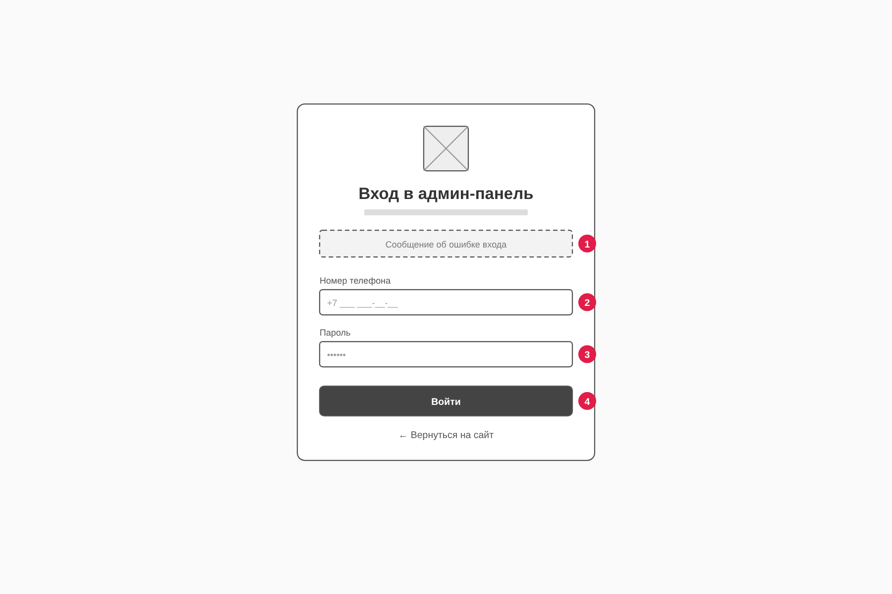
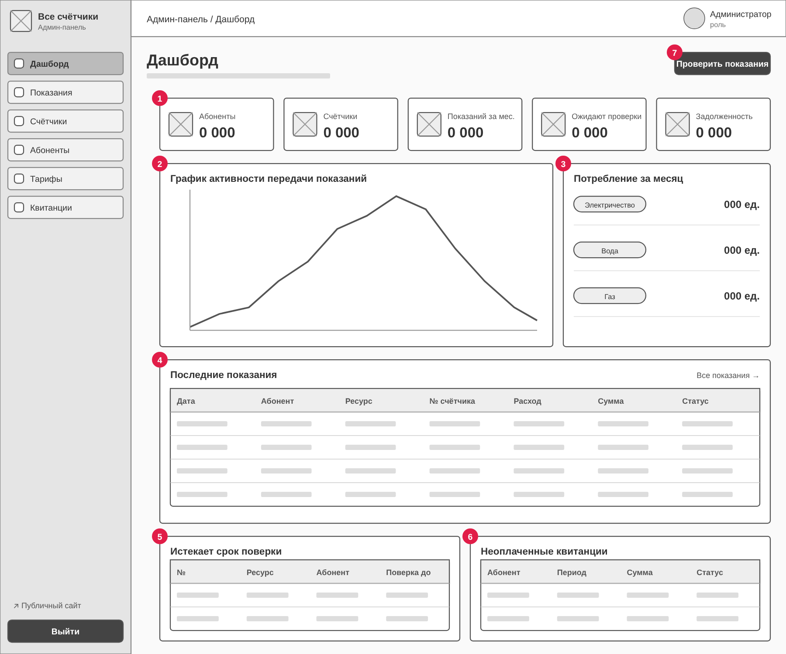
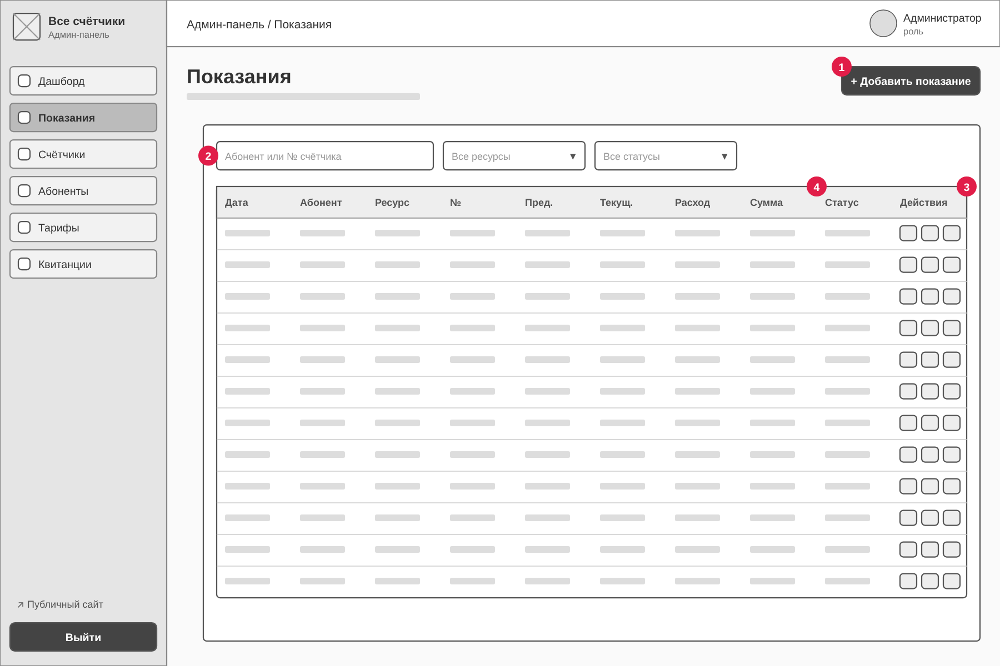
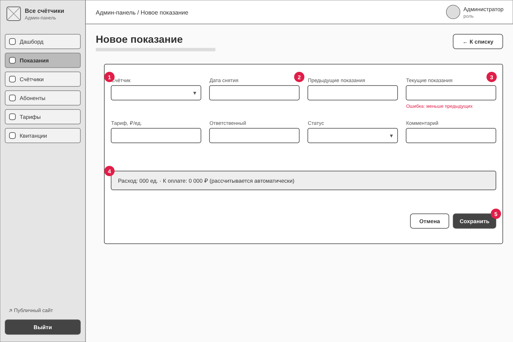
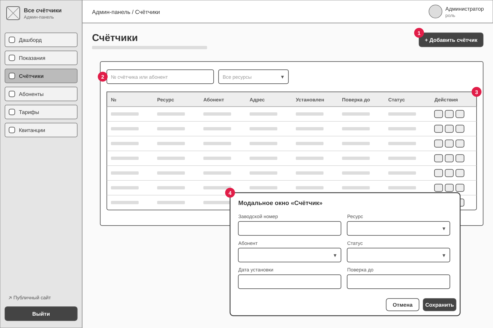
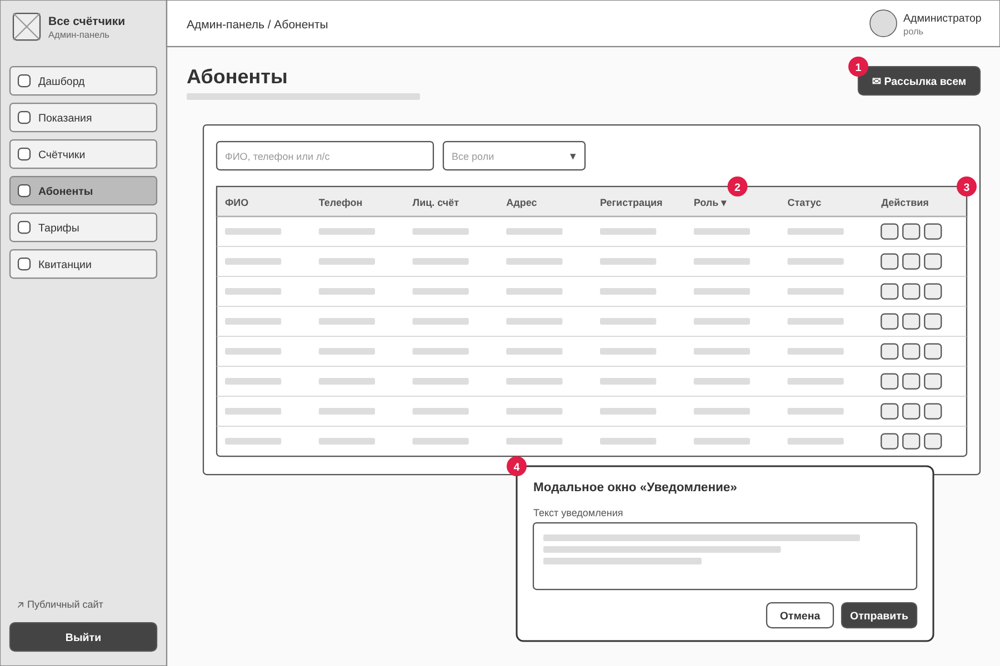
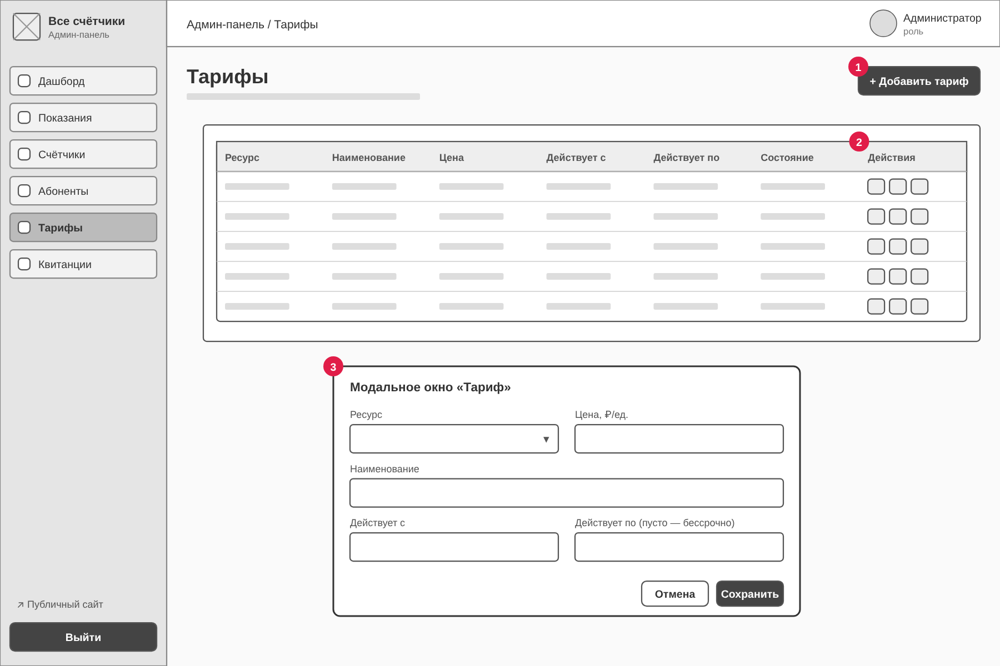
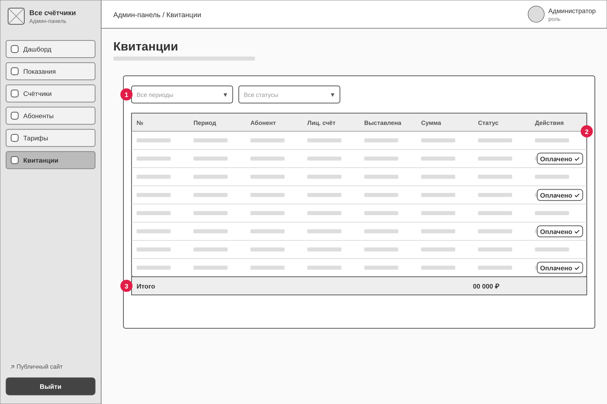

# Техническое задание на разработку административной панели сайта «Все счётчики»

Спецификация составлена в сокращённой форме по структуре ГОСТ 34.602-2020 («Техническое задание на создание автоматизированной системы»).

## 1. Общие сведения

| Параметр | Значение |
|---|---|
| Наименование системы | Административная панель сайта «Все счётчики» (далее — админ-панель) |
| Условное обозначение | `meters-admin` |
| Основание | Лабораторная работа №7 «Проектирование админ-панели, установка окружения Vue.js» |
| Связанная система | Публичная часть сайта передачи показаний счётчиков (каталог репозитория, страницы `index.html`, `archive.html`, `input.html`, `receipt.html`, `login.html`) |
| Архитектура | SPA (Single Page Application) на Vue.js 3 + Vite, Vue Router, Pinia, Axios |
| Сроки | Этап 1 (ЛР №7): требования, прототипы, каркас приложения. Последующие этапы: подключение API, production-сборка |

## 2. Назначение и цели создания

**Назначение.** Админ-панель предназначена для сотрудников управляющей компании (администраторов и операторов) и служит для контроля и обработки данных, которые абоненты передают через публичную часть сайта.

**Цели:**

1. Сократить время проверки переданных показаний за счёт единого списка с фильтрами и модерацией в один клик.
2. Исключить ошибки начислений: централизованное управление тарифами и автоматический расчёт суммы.
3. Обеспечить своевременную поверку приборов учёта (контроль сроков).
4. Контролировать оплату квитанций и задолженность абонентов.

## 3. Характеристика объекта автоматизации

Публичная часть сайта позволяет абоненту:

- войти по номеру телефона и паролю (`login.html`);
- просматривать обзор потребления электроэнергии, воды и газа (`index.html`);
- просматривать архив показаний с фильтрами по № счётчика, периоду и типу ресурса (`archive.html`);
- передавать показания: № счётчика, дата снятия, предыдущие/текущие показания, ответственный (`input.html`);
- получать квитанцию об оплате за месяц (`receipt.html`).

Админ-панель **работает с теми же сущностями и той же базой данных**, что и публичная часть (счётчики, показания, тарифы, квитанции, пользователи). Изменения, внесённые в админ-панели (например, принятие показания или новый тариф), сразу становятся видны абонентам. Добавление административного API не должно требовать переписывания существующего кода публичной части: новые маршруты добавляются в отдельное пространство `/api/*`, а ответы используют существующую структуру записей.

## 4. Требования к системе

### 4.1. Роли пользователей

| Роль | Доступ |
|---|---|
| Администратор (`admin`) | Все разделы, смена ролей пользователей, управление тарифами |
| Оператор (`operator`) | Дашборд, показания, счётчики, абоненты (без смены ролей), квитанции |
| Абонент (`abonent`) | Доступа к админ-панели нет — только публичная часть |

### 4.2. Функциональные требования

**ФТ-1. Авторизация.** Вход по номеру телефона и паролю (как на публичном сайте). После успешного входа сервер выдаёт токен доступа (JWT), который передаётся в заголовке `Authorization: Bearer <token>`. Все страницы, кроме страницы входа, защищены. При ответе сервера `401` сессия завершается и выполняется переход на страницу входа. Предусмотрен выход из системы.

**ФТ-2. Дашборд (стартовая страница):**

- карточки: количество абонентов, счётчиков, показаний за текущий месяц, показаний, ожидающих проверки, общая задолженность;
- график активности передачи показаний по дням (последние 14 дней);
- потребление за месяц по ресурсам (электричество, вода, газ);
- таблица 5 последних показаний;
- список счётчиков, у которых срок поверки истекает в ближайшие 3 месяца;
- список неоплаченных и просроченных квитанций.

**ФТ-3. Показания (модерация):**

- список всех показаний: дата, абонент, ресурс, № счётчика, предыдущие и текущие показания, расход, сумма, статус;
- поиск по абоненту или № счётчика; фильтры по ресурсу и статусу (`На проверке`, `Принято`, `Отклонено`);
- действия: **принять**, **отклонить с указанием причины** (причина сохраняется и показывается абоненту), редактировать, удалить;
- добавление показания вручную за абонента (например, при передаче по телефону);
- форма показания: выбор счётчика, дата, предыдущие показания (подставляются из последнего принятого), текущие показания, тариф (подставляется действующий по ресурсу), ответственный, статус, комментарий;
- валидация: текущие показания не могут быть меньше предыдущих (то же правило, что в `input.html`);
- автоматический расчёт расхода и суммы к оплате.

**ФТ-4. Счётчики:** CRUD приборов учёта; поля: заводской номер (не менее 5 цифр), ресурс, абонент, дата установки, срок поверки, статус (`Работает`, `Нужна поверка`, `Выведен`); поиск и фильтр по ресурсу.

**ФТ-5. Абоненты:** просмотр пользователей (ФИО, телефон, лицевой счёт, адрес, дата регистрации); смена роли; блокировка и разблокировка; отправка уведомлений, личных или общей рассылкой (например, напоминание о сроках передачи показаний).

**ФТ-6. Тарифы:** CRUD тарифов; поля: ресурс, наименование, цена за единицу, период действия. Тариф без даты окончания считается действующим и подставляется при расчёте.

**ФТ-7. Квитанции:** список начислений (период, абонент, лицевой счёт, дата выставления, сумма, статус оплаты); фильтры по периоду и статусу; итоговая сумма по выборке; ручная отметка об оплате.

### 4.3. Требования к интерфейсу

1. Двухколоночный макет: слева фиксированная боковая панель навигации с логотипом, разделами, ссылкой на публичный сайт и кнопкой «Выйти»; сверху строка с «хлебными крошками» и профилем пользователя; справа рабочая область.
2. Активный раздел подсвечивается в меню.
3. Цветовая палитра и шрифт совпадают с публичной частью (основной цвет `#2563eb`; цвета ресурсов: электричество — жёлто-оранжевый, вода — голубой, газ — оранжевый).
4. Статусы отображаются цветными бейджами: зелёный — успешно, жёлтый — требует внимания, красный — ошибка или просрочка.
5. Создание и редактирование простых сущностей (счётчик, тариф, уведомление, причина отклонения) выполняется в модальных окнах; показания редактируются на отдельной странице.
6. Опасные действия (удаление) требуют подтверждения.
7. Адаптивность: при ширине экрана меньше 800 px боковая панель превращается в горизонтальное меню, таблицы прокручиваются по горизонтали.
8. Состояния загрузки и ошибок отображаются на каждой странице.

### 4.4. Нефункциональные требования

| Категория | Требование |
|---|---|
| Технологии | Node.js LTS (≥ 22), Vue 3 (Composition API, `<script setup>`), Vite, Vue Router, Pinia, Axios |
| Производительность | Переходы между разделами без перезагрузки страницы (SPA); первичная загрузка < 2 с; размер production-бандла JS < 300 КБ |
| Безопасность | Защита маршрутов (navigation guards); токен в заголовке `Authorization`; страницы админки закрыты от индексации (`noindex`); в production — только HTTPS |
| Конфигурация | Адрес API и параметры прокси задаются переменными окружения с префиксом `VITE_` (файл `.env`) |
| Разработка | Прокси `/api` → бэкенд в dev-сервере Vite (без CORS); mock-адаптер для работы без бэкенда |
| Совместимость | Последние версии Chrome, Firefox, Edge, Safari |
| Код | Форматирование Prettier; единый стиль именования; комментарии на русском |

### 4.5. Требования к API (REST, префикс `/api`)

| Метод | Путь | Назначение |
|---|---|---|
| POST | `/auth/login` | Вход: `{ phone, password }` → `{ accessToken, user }` |
| GET | `/auth/me` | Текущий пользователь |
| GET | `/dashboard` | Сводная статистика для дашборда |
| GET / POST | `/readings` | Список показаний / добавление |
| GET / PUT / DELETE | `/readings/:id` | Получение / изменение / удаление показания |
| PATCH | `/readings/:id/status` | Модерация: `{ status, comment }` |
| GET / POST | `/meters` | Список счётчиков / добавление |
| PUT / DELETE | `/meters/:id` | Изменение / удаление счётчика |
| GET | `/users` | Список пользователей |
| PUT | `/users/:id` | Изменение роли и статуса |
| POST | `/notifications` | Уведомление: `{ userId \| null, message }` (`null` — всем) |
| GET / POST | `/tariffs` | Список тарифов / добавление |
| PUT / DELETE | `/tariffs/:id` | Изменение / удаление тарифа |
| GET | `/receipts` | Список квитанций |
| PUT | `/receipts/:id` | Изменение (отметка об оплате) |

### 4.6. Модель данных (общая с публичной частью)

| Сущность | Поля |
|---|---|
| `users` | id, name, phone, account (лицевой счёт), address, role, status, createdAt |
| `meters` | id, number, resource (`electricity` / `water` / `gas`), userId, installedAt, verifiedUntil, status |
| `readings` | id, meterId, date, prev, current, tariff, responsible, status, comment |
| `tariffs` | id, resource, name, price, unit, validFrom, validTo |
| `receipts` | id, userId, period (`YYYY-MM`), amount, status, issuedAt |

Расход и сумма показания вычисляются: `consumption = current − prev`, `amount = consumption × tariff`.

## 5. Lo-fi прототипы основных страниц

Прототипы выполнены в виде вайрфреймов в оттенках серого (исходники SVG и PNG находятся в `docs/prototypes/lofi/`). Красными цифрами отмечены элементы, описанные под каждым рисунком. Общие элементы на всех страницах: боковая панель (логотип, меню из 6 разделов, ссылка на публичный сайт, кнопка «Выйти») и верхняя строка («хлебные крошки», профиль).

### 5.1. Вход

1. Блок сообщения об ошибке (показывается при неверных данных).
2. Поле «Номер телефона».
3. Поле «Пароль».
4. Кнопка «Войти»; ниже ссылка возврата на публичный сайт.

### 5.2. Дашборд

1. Карточки ключевых показателей (абоненты, счётчики, показания за месяц, ожидают проверки, задолженность).
2. Линейный график активности передачи показаний по дням.
3. Потребление за месяц по ресурсам.
4. Таблица последних показаний со ссылкой на полный список.
5. Счётчики с истекающим сроком поверки.
6. Неоплаченные квитанции.
7. Быстрый переход к показаниям, ожидающим проверки.

### 5.3. Показания

1. Кнопка добавления показания вручную.
2. Панель фильтров: поиск, ресурс, статус.
3. Кнопки действий в строке: принять, отклонить, редактировать, удалить.
4. Статус показания (бейдж) и причина отклонения.

### 5.4. Форма показания (создание и редактирование)

1. Выбор счётчика (номер, ресурс, абонент).
2. Предыдущие показания, подставляются автоматически.
3. Текущие показания с выводом ошибки валидации.
4. Блок автоматического расчёта расхода и суммы.
5. Кнопки «Отмена» и «Сохранить».

### 5.5. Счётчики

1. Кнопка добавления счётчика.
2. Поиск и фильтр по ресурсу.
3. Действия: редактировать, удалить.
4. Модальное окно с формой счётчика.

### 5.6. Абоненты

1. Кнопка общей рассылки уведомлений.
2. Выпадающий список для смены роли прямо в таблице.
3. Действия: личное уведомление, блокировка и разблокировка.
4. Модальное окно с текстом уведомления.

### 5.7. Тарифы

1. Кнопка добавления тарифа.
2. Действия: редактировать, удалить.
3. Модальное окно с формой тарифа (пустая дата окончания означает бессрочный тариф).

### 5.8. Квитанции

1. Фильтры по периоду и статусу оплаты.
2. Кнопка «Отметить оплату» для неоплаченных квитанций.
3. Строка «Итого» по текущей выборке.

## 6. Hi-fi прототипы

Hi-fi прототипы выполнены как статичные HTML-страницы в итоговой дизайн-системе (`docs/prototypes/hifi/*.html`, со скриншотами `*.png`). Страницы связаны ссылками, поэтому прототип кликабелен: его можно открыть в браузере без сборки проекта.

## 7. Состав работ этапа 1

1. Разработка ТЗ и lo-fi прототипов.
2. Разработка hi-fi прототипов.
3. Установка Node.js и создание проекта Vue с помощью Vite (`create-vue`), установка Vue Router, Pinia, Axios.
4. Настройка маршрутизации и хранилищ.
5. Настройка прокси для API.
6. Создание компонентов-заглушек всех страниц по прототипам.
7. Проверка работоспособности в локальном окружении.

## 8. Порядок контроля и приёмки

Проект принимается, если:

- выполняются `npm install`, `npm run dev`, `npm run build` без ошибок;
- все маршруты открываются, неавторизованный пользователь перенаправляется на `/login`;
- запросы `/api/*` проксируются на адрес из `VITE_PROXY_TARGET`;
- в режиме `VITE_USE_MOCKS=true` все страницы работают на демонстрационных данных, а в консоли браузера нет ошибок.
